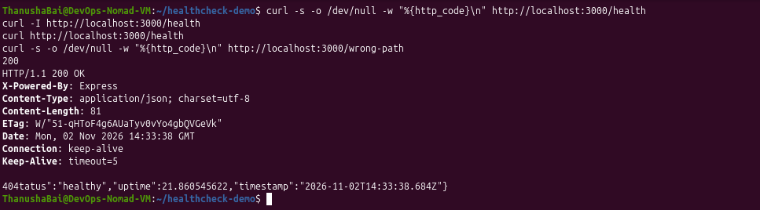
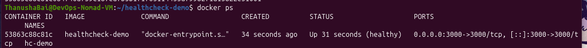
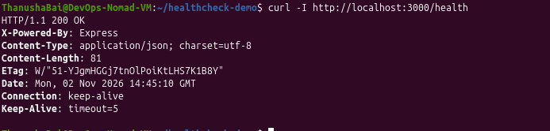
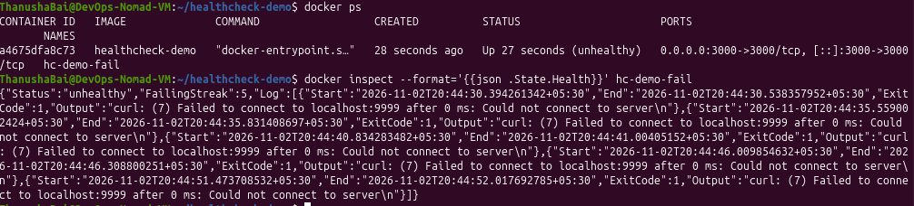

# Application Health Check Demo

## 📌 Objective
The purpose of this project is to demonstrate how to determine whether an application is running and responding correctly after deployment. It covers creating an HTTP health endpoint, testing it locally with `curl`, configuring a Docker `HEALTHCHECK`, and verifying the container's health status.

## 🛠️ Tech Stack
- **Application:** Node.js, Express.js
- **Containerization:** Docker
- **Testing Tools:** `curl`

## 📂 Project Structure
```text
healthcheck-demo/
├── app.js                      # Express application with the /health endpoint
├── package.json                # Node.js dependencies and scripts
├── Dockerfile                  # Docker configuration with HEALTHCHECK
├── .gitignore                  # Excludes node_modules from Git
├── .dockerignore               # Excludes node_modules from Docker build context
├── README.md                   # Project documentation (this file)
└── screenshots/                # Verification screenshots
    ├── 1-local-curl-tests.png
    ├── 2-docker-healthy.png
    ├── 3-docker-curl-200-ok.png
    └── 4-docker-unhealthy.png
```

## 🚀 Getting Started (Local)

1. **Install dependencies:**
   ```bash
   npm install
   ```

2. **Run the application locally:**
   ```bash
   node app.js
   ```
   *The app will start on `http://localhost:3000`.*

## 🩺 Health Check Endpoint

The application exposes a `/health` endpoint that returns a `200 OK` status code and a JSON payload when the application is healthy.

**Endpoint Details:**
- **URL:** `/health`
- **Method:** `GET`
- **Response (Healthy):**
  ```json
  {
    "status": "healthy",
    "uptime": 12.345,
    "timestamp": "2026-11-02T14:33:38.684Z"
  }
  ```

### Testing with `curl`
You can test the endpoint using the following commands:
```bash
# Check the HTTP Status Code
curl -s -o /dev/null -w "%{http_code}\n" http://localhost:3000/health

# Check the Headers
curl -I http://localhost:3000/health

# Check the JSON Body
curl http://localhost:3000/health

# Test error handling (404 Not Found)
curl -s -o /dev/null -w "%{http_code}\n" http://localhost:3000/wrong-path
```

**Local Test Results:**


---

## 🐳 Docker Configuration

### The Dockerfile
The Dockerfile uses `node:22-alpine` as the base image. Since Alpine doesn't include `curl` by default, we install it so the health check can function.

```dockerfile
FROM node:22-alpine

# Install curl for the health check
RUN apk add --no-cache curl

WORKDIR /app
COPY package*.json ./
RUN npm install --omit=dev
COPY app.js ./

EXPOSE 3000
CMD ["node", "app.js"]

# Docker Health Check
HEALTHCHECK --interval=15s --timeout=3s --start-period=10s --retries=3 \
  CMD curl -fsS http://localhost:3000/health || exit 1
```

### HEALTHCHECK Parameters Explained:
- `--interval=15s`: Docker checks the health every 15 seconds.
- `--timeout=3s`: If the check takes longer than 3 seconds, it is considered a failure.
- `--start-period=10s`: Allows the container 10 seconds to boot up before counting failures.
- `--retries=3`: The container is marked as `unhealthy` after 3 consecutive failures.
- `curl -fsS`: The `-f` flag ensures `curl` exits with an error code if the HTTP response is ≥ 400.

---

## 🏃‍♂️ Running the Container

1. **Build the Docker image:**
   ```bash
   docker build -t healthcheck-demo .
   ```

2. **Run the container:**
   ```bash
   docker run -d --name hc-demo -p 3000:3000 healthcheck-demo
   ```

3. **Verify the health status:**
   ```bash
   docker ps
   ```
   *The `STATUS` column should display `Up [time] (healthy)`.*

**Docker Container Healthy:**


**Curl Test from Docker Container:**


---

## ⚠️ Failure Simulation (Verification)

To prove that the health check works and accurately detects failures, we can simulate a failure by overriding the health check command to look at an incorrect port.

1. **Run a container with a broken health check:**
   ```bash
   docker run -d --name hc-demo-fail -p 3000:3000 \
     --health-cmd="curl -f http://localhost:9999/health || exit 1" \
     --health-interval=5s \
     --health-retries=2 \
     --health-timeout=2s \
     healthcheck-demo
   ```

2. **Wait 10–12 seconds** for the retries to exhaust, then check the status:
   ```bash
   docker ps
   ```
   *The `STATUS` column will now display `Up [time] (unhealthy)`.*

3. **Check the health logs:**
   ```bash
   docker inspect --format='{{json .State.Health}}' hc-demo-fail
   ```
   *You will see `"Status":"unhealthy"` and `curl: (7) Failed to connect to localhost port 9999`.*

**Docker Container Unhealthy (Failure Simulation):**


### 💡 Key Observations
- Docker's default `HEALTHCHECK` marks the container as `unhealthy` but **does not** automatically stop or restart it.
- In production environments, orchestrators (like Kubernetes or Docker Swarm) monitor this health status and will automatically restart or replace unhealthy containers.
- Killing the main `node` process (PID 1) inside an Alpine container using `pkill` or `kill` is often ignored by the OS. Using the `--health-cmd` override is a cleaner way to simulate health check failures in a test environment.
